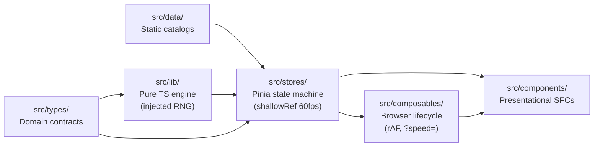
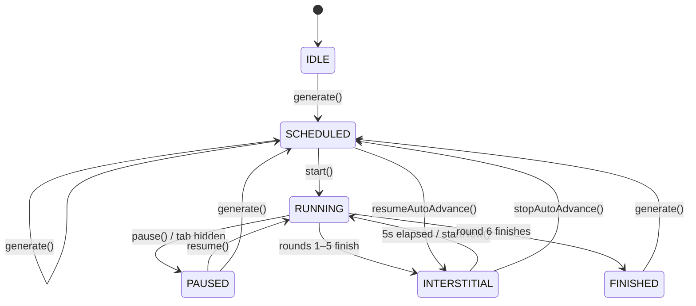

# horsider-one

[](https://github.com/akgunberk/horsider-one/actions/workflows/ci.yml)
[](https://github.com/akgunberk/horsider-one/actions/workflows/deploy.yml)

Interactive 6-round horse racing simulation built with **Vue 3**, **TypeScript (strict)**, **Pinia**, **Tailwind CSS v4**, and **shadcn-vue / Reka UI** for the Insider One Software Developer Assessment Project.

## Live Demo & Design

- **Live App:** <https://akgunberk.github.io/horsider-one/>
- **Fast Full-Race Demo (120× speed):** <https://akgunberk.github.io/horsider-one/?speed=120>
- **Storybook (Component & Page Catalog):** <https://akgunberk.github.io/horsider-one/storybook/>
- **UI Design (Google Stitch):** <https://stitch.google.com/projects/13069605755065839638>

## Quick Start

Requires **Node `^22.18.0 || >=24.12.0`** and **pnpm**.

```sh
pnpm install   # installs dependencies and activates .githooks/ via prepare
pnpm dev       # starts Vite dev server
```

> **Tip:** Append `?speed=60` or `?speed=120` in the URL to accelerate the 6-round simulation for quick manual verification.

## Requirements → Implementation

Mapped directly against the Insider One Software Developer Assessment Project brief:

| Assessment Brief                                                                     | Implementation                                                                                                                                                                                            | Verification                                                                                                                                                           |
| ------------------------------------------------------------------------------------ | --------------------------------------------------------------------------------------------------------------------------------------------------------------------------------------------------------- | ---------------------------------------------------------------------------------------------------------------------------------------------------------------------- |
| **Tech:** Vue.js + Pinia state management                                            | Vue 3 `<script setup lang="ts">`, Pinia setup store ([`src/stores/race.ts`](src/stores/race.ts))                                                                                                          | [`src/stores/race.spec.ts`](src/stores/race.spec.ts)                                                                                                                   |
| **20 horses**, unique colors, condition **1–100**                                    | [`src/lib/generation.ts`](src/lib/generation.ts), [`src/data/horseNames.ts`](src/data/horseNames.ts), [`src/data/horseColors.ts`](src/data/horseColors.ts)                                                | [`src/lib/generation.spec.ts`](src/lib/generation.spec.ts)                                                                                                             |
| **Generate Race Schedule:** 6 rounds (`1200m` → `2200m`), 10 random horses per round | `ROUND_DISTANCES`, `generateRounds()` with Fisher–Yates shuffle ([`src/lib/generation.ts`](src/lib/generation.ts), [`src/lib/random.ts`](src/lib/random.ts))                                              | [`src/lib/generation.spec.ts`](src/lib/generation.spec.ts), [`src/lib/random.spec.ts`](src/lib/random.spec.ts)                                                         |
| **Start the Race:** run sequentially, one round at a time                            | 6-phase state machine + 5s interstitial auto-advance with Stop / Resume / Start Now ([`src/stores/race.ts`](src/stores/race.ts))                                                                          | [`src/stores/race.spec.ts`](src/stores/race.spec.ts), [`e2e/vue.spec.ts`](e2e/vue.spec.ts)                                                                             |
| **Display Race Results:** sequentially as each round concludes                       | `recordResult()` + `finishOrder()` + [`ResultsPanel.vue`](src/components/race/results-panel/ResultsPanel.vue)                                                                                             | [`src/lib/race.spec.ts`](src/lib/race.spec.ts), [`ResultsPanel.spec.ts`](src/components/race/results-panel/ResultsPanel.spec.ts), [`e2e/vue.spec.ts`](e2e/vue.spec.ts) |
| **Animated Horse Movement:** smooth visible motion                                   | `requestAnimationFrame` loop ([`useRaceLoop.ts`](src/composables/useRaceLoop.ts)) + GPU `transform` with container-query width ([`LaneProgress.vue`](src/components/race/lane-progress/LaneProgress.vue)) | [`useRaceLoop.spec.ts`](src/composables/useRaceLoop.spec.ts), [`LaneProgress.spec.ts`](src/components/race/lane-progress/LaneProgress.spec.ts)                         |
| **Component-Based Design & Large-Scale Code Style**                                  | Layered architecture enforced by ESLint + structural gate ([`docs/architecture.md`](docs/architecture.md), [`eslint.config.ts`](eslint.config.ts))                                                        | [`scripts/verify.ts`](scripts/verify.ts)                                                                                                                               |
| **Bonus — Unit Tests**                                                               | Vitest + `@vue/test-utils` across engine, store, composables, and all race components (≥85% V8 coverage gate)                                                                                             | `pnpm test:coverage`                                                                                                                                                   |
| **Bonus — E2E Tests**                                                                | Playwright full 6-round lifecycle across Chromium, Firefox, and WebKit ([`e2e/vue.spec.ts`](e2e/vue.spec.ts))                                                                                             | `pnpm test:e2e`                                                                                                                                                        |
| **Bonus — Visual Tests**                                                             | Chromatic cloud snapshots with TurboSnap on Storybook stories + PR approval gate ([`.github/workflows/ci.yml`](.github/workflows/ci.yml))                                                                 | `pnpm test:visual` / CI `visual` job                                                                                                                                   |

## Engineering Highlights

- **Pure, deterministic simulation engine:** [`src/lib/`](src/lib/) has zero Vue or Pinia imports and bans raw `Math.random()`. All randomness flows through an injected `rng: () => number`, enabling repeatable unit tests and deterministic Storybook page states via [`seededRng()`](src/test/rng.ts).
- **Frame-rate independent finish ordering:** Finish times interpolate exact sub-frame overshoot (`elapsed + remainingDistance / speed`), with deterministic tie-breaking by horse `id`.
- **Safe animation lifecycle:** [`useRaceLoop.ts`](src/composables/useRaceLoop.ts) guards against duplicate `requestAnimationFrame` loops (`rafId`), clamps frame `dt` to `50ms`, and uses VueUse (`useDocumentVisibility`, `useWindowFocus`) to pause cleanly when the tab is backgrounded or blurred.
- **60fps rendering without deep reactivity overhead:** Live runner progress lives behind `shallowRef` in Pinia, and lane movement animates only `transform: translateX(calc(var(--p) * (100cqi - 100%)))` inside `container-type: inline-size` lanes (no layout thrashing via `left`/`margin-left`).
- **Explicit state machine:** Every action button (`Generate / Regenerate`, `Start / Pause / Resume`, `Stop / Resume Auto-Advance`, `Start Now`) is driven by derived `computed()` guards from the current `RacePhase`.
- **Accessibility & responsive layout:** Mobile-first flexbox/grid layout with a single-viewport mobile experience (internal scrolling panels, zero page scroll), native `<button>` controls, `aria-live="polite"` phase announcements, and `usePreferredReducedMotion()` support.

## Architecture

Dependency direction flows strictly downward and is enforced at lint time. See [`docs/architecture.md`](docs/architecture.md) and [`SPEC.md`](SPEC.md) for full details.



### Race State Machine



## Design-to-Code (Google Stitch & Stitch MCP)

The UI was designed in **Google Stitch** ([project link](https://stitch.google.com/projects/13069605755065839638)) and implemented directly from the design using the **Stitch MCP server** configured in [`opencode.jsonc`](opencode.jsonc):

```jsonc
{
  "mcp": {
    "stitch": {
      "type": "remote",
      "url": "https://stitch.googleapis.com/mcp",
      "enabled": true,
      "headers": {
        "X-Goog-Api-Key": "${STITCH_API_KEY}",
      },
    },
  },
}
```

- Agents inspected Stitch screens, layout hierarchy, spacing, and color tokens over MCP instead of working from static image guesses.
- Design tokens map into Tailwind CSS v4 `@theme` definitions in [`src/style.css`](src/style.css), including brand tokens, the 10-lane track palette, and self-hosted variable fonts (`@fontsource-variable/inter`, `@fontsource-variable/wix-madefor-display`, `@fontsource-variable/spline-sans-mono`) so rendering stays identical across environments and visual snapshots.

## Agent-Assisted Development Workflow

This repository was built using **multi-model agent workflows via `opencode` + Stitch MCP**, structured so multiple models and sessions produce consistent, maintainable code rather than drifting.

### 1. Layered Context Documents

- [`AGENTS.md`](AGENTS.md) — short, high-signal invariants loaded every session (package manager, verification commands, core invariants, composable policy).
- [`SPEC.md`](SPEC.md) — single source of truth for domain rules, simulation math, state-machine transitions, responsive breakpoints, and edge cases.
- [`docs/`](docs/) — focused per-area playbooks ([`architecture.md`](docs/architecture.md), [`typescript.md`](docs/typescript.md), [`simulation.md`](docs/simulation.md), [`components.md`](docs/components.md), [`composables.md`](docs/composables.md), [`testing.md`](docs/testing.md)).
- [`.agents/skills/`](.agents/skills/) — reusable workflow skills (e.g., Conventional Commits).

### 2. Guardrails as Code (Not Just Documentation)

Prose guidelines alone erode across long sessions, so every critical invariant is mechanically enforced:

- **Layer & determinism lint rules** ([`eslint.config.ts`](eslint.config.ts)): forbids Vue/Pinia/VueUse/store/component imports and raw `Math.random()` inside `src/lib/`; enforces strict import boundaries for `src/stores/` and `src/composables/`.
- **Structural gate** ([`scripts/verify.ts`](scripts/verify.ts)): enforces a flat `src/composables/` directory and forbids barrel `index.ts` files in app-owned component folders (`src/components/{race,layout}/`) to keep bundler module graphs exact.
- **Git hooks** ([`.githooks/`](.githooks/)): blocks direct commits to `main`, enforces Conventional Commits (`commit-msg`), and runs staged verification (`pre-commit`).
- **Tiered verification loop** ([`scripts/verify.ts`](scripts/verify.ts)): quiet one-line-per-step output (full logs only on failure) keeps the agent inner loop fast (`verify:changed`) while `verify:handoff` automatically triggers Storybook interaction and Playwright E2E tests based on changed paths.
- **Incremental feature branches:** the git history reflects vertical slices (`types` → `simulation engine` → `store & rAF loop` → `design tokens & primitives` → `race UI` → `app integration & E2E` → `gates & visual CI`).

## Testing & Quality Gates

Full details in [`docs/testing.md`](docs/testing.md).

| Layer                     | Tooling                                             | Scope & Enforcement                                                                                                                                |
| ------------------------- | --------------------------------------------------- | -------------------------------------------------------------------------------------------------------------------------------------------------- |
| **Unit**                  | Vitest + `@vue/test-utils` (`jsdom`)                | Pure simulation engine, PRNG, Pinia store transitions, composables, and co-located component specs. **85% V8 coverage thresholds** enforced in CI. |
| **Component Interaction** | Storybook 10 + `@storybook/addon-vitest` (Chromium) | Every component and full-page story (`Pages/Horse Racing`) runs `play` assertions against accessible roles and live interactions.                  |
| **Visual Regression**     | Chromatic (TurboSnap)                               | Cloud Chrome snapshots of Storybook stories. PRs block until diffs are reviewed and approved; `main` auto-accepts baselines.                       |
| **End-to-End**            | Playwright (Chromium, Firefox, WebKit)              | Full 6-round race lifecycle using `/?speed=120`, asserting state via `[data-phase="FINISHED"]` with zero arbitrary sleeps.                         |

## Scripts

| Command               | Purpose                                                                   |
| --------------------- | ------------------------------------------------------------------------- |
| `pnpm dev`            | Start Vite dev server                                                     |
| `pnpm build`          | Type-check (`vue-tsc`) and production build                               |
| `pnpm preview`        | Preview production build locally                                          |
| `pnpm verify:changed` | Fast diff-scoped gate vs `main` (`vue-tsc`, `eslint`, related unit tests) |
| `pnpm verify`         | Full fast gate (`structure`, `vue-tsc`, `eslint .`, all unit tests)       |
| `pnpm verify:handoff` | `verify` + path-triggered Storybook interaction and Chromium E2E tests    |
| `pnpm test:unit`      | Run Vitest unit suite in watch mode                                       |
| `pnpm test:coverage`  | Run unit tests with V8 coverage (85% threshold)                           |
| `pnpm test:storybook` | Run Storybook interaction tests headless in Chromium                      |
| `pnpm test:e2e`       | Run Playwright E2E suite across Chromium, Firefox, and WebKit             |
| `pnpm storybook`      | Launch local Storybook on port 6006                                       |
| `pnpm lint`           | Run `oxlint` + `eslint --fix`                                             |

## Project Structure

```text
src/
├── types/          # Pure domain types (Horse, RacePhase, RoundPlan, RoundResult)
├── data/           # Static horse name/color catalogs and Storybook fixtures
├── lib/            # Pure TS engine: PRNG, roster/round generation, physics & finish math
├── stores/         # Pinia setup store (useRaceStore) — phase machine & derived getters
├── composables/    # Flat browser-lifecycle composables (useRaceLoop, useSpeedMultiplier)
├── components/
│   ├── layout/     # AppHeader
│   ├── race/       # Co-located SFC + spec + story per component (no barrel files)
│   └── ui/         # shadcn-vue / Reka UI primitives
├── stories/        # Full-page App stories (Pages/Horse Racing) & Component Library overview
└── test/           # Deterministic RNG helpers (sequenceRng, seededRng) & test setup
```

## Deployment

[`.github/workflows/deploy.yml`](.github/workflows/deploy.yml) deploys both the app (`VITE_BASE=/horsider-one/`) and the static Storybook (`SB_BASE=/horsider-one/storybook/`) to GitHub Pages on every push to `main`.

## Trade-offs & Next Steps

- **No app-owned barrel files:** Direct SFC imports avoid pulling unused components into chunks and keep the dependency graph explicit.
- **Potential next steps:** `?seed=` URL parameter for shareable race replays, localStorage session persistence, i18n, and optional sound/commentary cues.
